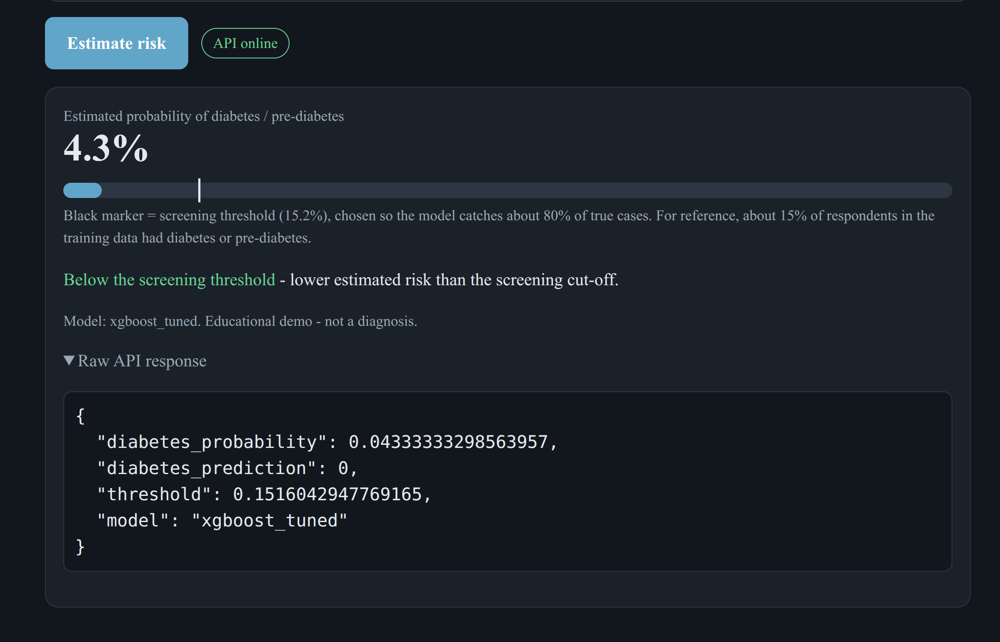
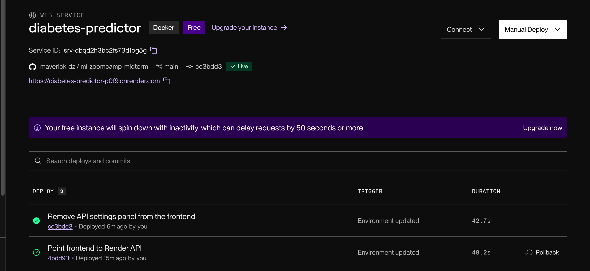

# Diabetes Health Indicators - ML Zoomcamp Midterm Project

Predict whether a person has diabetes or pre-diabetes from CDC BRFSS 2015 survey answers, and serve the model as a
web API (**Render**) with a small web UI (**Cloudflare Pages**).

|                        |                                                   |
| ---------------------- | ------------------------------------------------- |
| **Live demo (UI)**     | https://ml-zoomcamp-midterm.kcirevam.workers.dev  |
| **Live API (Swagger)** | https://diabetes-predictor-p0f9.onrender.com/docs |




> Render's free plan sleeps after 15 minutes without traffic; the first request afterwards can take up to a minute.

---

## 1. Problem statement

Diabetes affects roughly 1 in 10 adults and is a leading cause of cardiovascular disease, kidney failure and blindness.
**Early screening** - flagging people at elevated risk so they can be referred for a confirmatory blood test (HbA1c) - is one of
the most cost-effective public-health interventions.

This project trains a binary classifier that, from 21 self-reported lifestyle and health indicators, returns the **probability that a
respondent has diabetes or pre-diabetes**. It is designed as a **first-stage screening tool**: the probability is thresholded
to decide who should be referred. Missing a true case is worse than a false alarm, so the threshold is chosen to reach a
**target recall of 80%**, and the cost of that choice (precision) is reported openly.

**Metrics.** ROC-AUC and average precision (threshold-free) for model selection; precision / recall / specificity / F1 at the
chosen threshold; Brier score and a calibration curve for probability quality.

> **Not a medical device.** The model is trained on self-reported, cross-sectional survey data and cannot diagnose diabetes.

## 2. Dataset

- **Source:** [CDC Diabetes Health Indicators](https://www.kaggle.com/datasets/alexteboul/diabetes-health-indicators-dataset)
  (also [UCI dataset 891](https://archive.ics.uci.edu/dataset/891/cdc+diabetes+health+indicators)), file
  `diabetes_binary_health_indicators_BRFSS2015.csv`, committed under `data/` (~22 MB).
- **Raw size:** 253,680 rows, 21 features + target `diabetes_binary` (0 = no diabetes, 1 = pre-diabetes or diabetes).
- **Not** one of the datasets excluded by the course (car prices, Telco churn, credit risk, clothing classification).

### Data quality: duplicates

No missing values, but **24,206 rows (9.5%) are exact duplicates**, and only 1.0% of those duplicates are positive (vs 13.9% overall).
Because a random split puts copies of one row on both sides, test scores get inflated: with the same default XGBoost model,
test AUC is **0.826 on the raw split vs 0.817 after de-duplication**, and 12.0% of raw test rows had an identical twin in the
training set (0.8% after cleaning - those are identical answers with a different label). Everything in this project uses the
**de-duplicated data: 229,474 rows, 15.3% positive**. A further 1,566 identical-answer profiles occur with both labels, which is
irreducible noise that caps achievable accuracy.

### Feature dictionary

| Feature                                                                                                                                                                                    | Meaning                                               | Range  |
| ------------------------------------------------------------------------------------------------------------------------------------------------------------------------------------------ | ----------------------------------------------------- | ------ |
| `highbp`, `highchol`, `cholcheck`, `smoker`, `stroke`, `heartdiseaseorattack`, `physactivity`, `fruits`, `veggies`, `hvyalcoholconsump`, `anyhealthcare`, `nodocbccost`, `diffwalk`, `sex` | yes/no indicators (`sex`: 0=female, 1=male)           | 0/1    |
| `bmi`                                                                                                                                                                                      | body-mass index                                       | 10-100 |
| `genhlth`                                                                                                                                                                                  | self-rated general health (1=excellent ... 5=poor)    | 1-5    |
| `menthlth`, `physhlth`                                                                                                                                                                     | days of poor mental / physical health in past 30 days | 0-30   |
| `age`                                                                                                                                                                                      | 5-year age bucket (1=18-24 ... 13=80+)                | 1-13   |
| `education`                                                                                                                                                                                | 1=never attended ... 6=college graduate               | 1-6    |
| `income`                                                                                                                                                                                   | 1=under $10k ... 8=$75k or more                       | 1-8    |

These ranges are enforced by the API (`scoring.FEATURE_SPECS`).

## 3. EDA (see `notebook.ipynb`)

- **Imbalance:** 15.3% positive after cleaning -> handled by calibration + threshold tuning, not resampling.
- **Strongest binary signals** (rate difference diabetic - non-diabetic): high blood pressure (+0.35), high cholesterol (+0.27),
  difficulty walking (+0.22), heart disease/attack (+0.14); physical activity is protective (-0.12). Risk ratios: high BP 3.6x, difficulty walking 2.6x, high cholesterol 2.6x.
- **Ranked by mutual information with the target:** `genhlth`, `highbp`, `bmi`, `age`, `highchol`, `diffwalk`.
- Diabetes rate rises steeply with age bucket and BMI band; education and income are negatively related to the target.
- BMI has a long right tail (max 98; 0.35% of rows above 60) - kept, as tree models are insensitive and logistic regression is scaled.
- Figures: `artifacts/figures/01-04, 10`.

## 4. Modelling

Split **60 / 20 / 20** (train / validation / test), stratified. Candidates (no class weighting):

| Model                        | Val ROC-AUC | Val avg. precision | CV ROC-AUC                 |
| ---------------------------- | ----------- | ------------------ | -------------------------- |
| **XGBoost (tuned)**          | **0.8169**  | 0.4432             | 0.8149 +/- 0.0022 (5-fold) |
| XGBoost (default)            | 0.8147      | 0.4388             |                            |
| Random forest (tuned)        | 0.8132      | 0.4372             | 0.8098 +/- 0.0010 (3-fold) |
| Random forest                | 0.8119      | 0.4335             |                            |
| Logistic regression (scaled) | 0.8088      | 0.4112             |                            |
| Decision tree (depth 6)      | 0.7961      | 0.3994             |                            |

- **Tuning:** `RandomizedSearchCV` on the **full** training split - XGBoost 10 configurations x 5-fold, random forest 4 x 3-fold.
- **Selection:** highest validation ROC-AUC, picked in code. Honest caveat: the top models are within about 0.004 AUC of each other,
  and plain logistic regression is only 0.008 behind - the signal is largely additive, so a simple model is nearly as good.
- **Calibration and threshold** use out-of-fold predictions on train+validation (the test set plays no role): an isotonic calibrator,
  and the largest threshold that still gives **80% recall**. The final model is then refit on train+validation.
- **Final model:** XGBoost, `n_estimators=300, max_depth=6, learning_rate=0.03, subsample=0.7, colsample_bytree=0.8, min_child_weight=1, reg_lambda=1`, threshold **0.152**.

### Test-set results (evaluated once)

| Metric                                                 | Value                 |
| ------------------------------------------------------ | --------------------- |
| ROC-AUC                                                | **0.820**             |
| Average precision (base rate 0.153)                    | 0.444                 |
| Brier score (raw -> calibrated)                        | 0.10455 -> 0.10461    |
| **At the default threshold 0.152:** recall / precision | **0.815 / 0.309**     |
| specificity / F1 / accuracy                            | 0.671 / 0.448 / 0.693 |

Threshold trade-off (thresholds chosen on train+val, measured on test; `artifacts/threshold_table.csv`):

| Target recall     | Threshold | Test recall | Test precision | Test specificity |
| ----------------- | --------- | ----------- | -------------- | ---------------- |
| 70%               | 0.189     | 0.730       | 0.342          | 0.746            |
| **80% (default)** | **0.152** | **0.815**   | **0.309**      | **0.671**        |
| 90%               | 0.092     | 0.907       | 0.263          | 0.540            |

- **Calibration:** since no class weights are used, the raw probabilities were already well calibrated (Brier 0.10455 vs 0.10461,
  curves overlap in `08_calibration.png`). The isotonic step is a safety net, not a big correction.
- **Top predictors** (permutation importance on the test set): general health, BMI, age, high blood pressure, high cholesterol.
- **Why lower than before?** An earlier version of this project reported AUC 0.827 on the raw data; the lower, honest number
  reflects removing duplicate rows that leaked between train and test.

Figures: `artifacts/figures/05_confusion_matrix.png`, `06_roc_pr_curves.png`, `07_feature_importance.png`, `08_calibration.png`, `09_threshold_tradeoff.png`.

## 5. Project structure

```
ml-zoomcamp-midterm/
├── README.md
├── requirements.txt          # development deps (training, notebook, tests)
├── requirements-serve.txt    # slim runtime deps (Docker / Render / CI)
├── Dockerfile                # FastAPI service image (listens on $PORT)
├── render.yaml               # Render Blueprint (free plan, Docker)
├── scoring.py                # feature schema + scoring logic (shared by API, Lambda, training)
├── predict.py                # FastAPI app: /predict, /health, /docs
├── train.py                  # full pipeline: dedupe -> CV tuning -> calibration -> model.bin + artifacts
├── notebook.ipynb            # EDA + step-by-step modelling (executed; imports train.py)
├── model.bin                 # pickled {model, calibrator, threshold, feature list, versions}
├── sample_request.json
├── data/                     # BRFSS CSV
├── artifacts/                # metrics.json, model_comparison.csv, threshold_table.csv, figures/
├── tests/test_predict.py     # pytest (21 tests)
├── frontend/                 # static UI for Cloudflare Pages (index.html, config.js)
├── aws/                      # OPTIONAL Lambda container-image deployment (not tested by the author)
└── .github/workflows/ci.yml  # runs pytest + Docker smoke test on every push
```

## 6. Run it locally

Requires **Python 3.12+** (the pinned NumPy/SciPy need it).

```bash
git clone https://github.com/maverick-dz/ml-zoomcamp-midterm.git && cd ml-zoomcamp-midterm
python -m venv venv
source venv/bin/activate            # Windows: venv\Scripts\activate
pip install -r requirements.txt
```

| Task                                                        | Command                                                    |
| ----------------------------------------------------------- | ---------------------------------------------------------- |
| Retrain (writes `model.bin` + `artifacts/`; ~4-10 min)      | `python train.py`                                          |
| Quick smoke-test of the pipeline (~1 min, writes elsewhere) | `python train.py --quick --out-dir /tmp/quick`             |
| Run the notebook                                            | `jupyter lab notebook.ipynb` (start from the project root) |
| Run the tests                                               | `pytest`                                                   |
| Start the API                                               | `uvicorn predict:app --host 0.0.0.0 --port 9696`           |

```bash
curl http://localhost:9696/health
# {"status":"ok"}
curl -X POST http://localhost:9696/predict -H "Content-Type: application/json" -d @sample_request.json
# {"diabetes_probability":0.3139,"diabetes_prediction":1,"threshold":0.1516,"model":"xgboost_tuned"}
```

Swagger UI: <http://localhost:9696/docs>. To try the web UI locally: `python -m http.server 8000 --directory frontend`, open <http://localhost:8000>
(`frontend/config.js` points to the live Render API; to use a local API, temporarily set window.API_URL to `http://localhost:9696`).

### Docker

```bash
docker build -t diabetes-predictor .
docker run --rm -p 9696:9696 diabetes-predictor
curl -X POST http://localhost:9696/predict -H "Content-Type: application/json" -d @sample_request.json
```

The image uses only `requirements-serve.txt` (no pandas/matplotlib/Jupyter), runs as a non-root user, and listens on `$PORT` (default 9696).

## 7. API reference

### `POST /predict`

Body: all 21 features (see the dictionary; unknown or out-of-range fields return HTTP 422). Optional query parameter
`?threshold=0.2` overrides the default decision threshold.

```json
{
  "diabetes_probability": 0.3139,
  "diabetes_prediction": 1,
  "threshold": 0.1516,
  "model": "xgboost_tuned"
}
```

`diabetes_probability` is a calibrated probability; `diabetes_prediction` is 1 when it is >= `threshold`.

### `GET /health` -> `{"status": "ok"}` | `GET /` -> model info, default threshold, disclaimer

Environment variables: `MODEL_PATH` (default `./model.bin`), `ALLOWED_ORIGINS` (CORS, comma-separated; default `*`).

## 8. Deploy: Render + Cloudflare Pages

Architecture: **browser -> Cloudflare Pages (static UI) -> Render (FastAPI in Docker)**.

**A. API on Render**

1. Push this repo to GitHub (public).
2. Render dashboard -> **New + -> Blueprint** -> connect the repo -> Render reads `render.yaml` -> **Apply**.
   (Alternative: **New + -> Web Service** -> your repo -> _Language: Docker_ -> _Instance type: Free_ -> _Health check path:_ `/health`.)
3. Wait for the build (a few minutes). Your URL looks like `https://diabetes-predictor.onrender.com`. Test `/health`, `/docs` and `/predict`.

**B. UI on Cloudflare Pages**

1. In `frontend/config.js` set `window.API_URL` to your Render URL, commit and push.
2. Cloudflare dashboard -> **Workers & Pages -> Create -> Pages -> Connect to Git** -> pick the repo.
   Framework preset _None_, **build command: leave empty**, **build output directory: `frontend`** -> **Save and Deploy**.
   (Direct-upload alternative: `npx wrangler pages deploy frontend --project-name diabetes-risk-demo`.)
3. Open `https://<project>.pages.dev` and run a prediction.

**C. Lock down CORS (recommended).** In Render -> your service -> _Environment_, set `ALLOWED_ORIGINS` to your Pages URL
(e.g. `https://diabetes-risk-demo.pages.dev`) and redeploy.

**D. Evidence for reviewers.** Add screenshots (Render service "Live", a successful `/predict` call or the UI result) to `docs/`
and link them in the table at the top of this README.

An optional AWS Lambda container-image setup is in `aws/` (`aws/DEPLOYMENT.md`); it has not been run end to end.

## 9. Where to find each evaluation criterion

| Criterion                           | Where                                                                                                                      |
| ----------------------------------- | -------------------------------------------------------------------------------------------------------------------------- |
| Problem description                 | section 1                                                                                                                  |
| EDA                                 | section 3, `notebook.ipynb`, `artifacts/figures/`                                                                          |
| Model training & tuning             | section 4, `notebook.ipynb`, `train.py`                                                                                    |
| Notebook exported to script         | `train.py` (imported by the notebook)                                                                                      |
| Reproducibility                     | fixed seed (`RANDOM_STATE=42`), data committed, pinned versions, `python train.py` regenerates `model.bin` and all metrics |
| Model deployment                    | `predict.py`, section 6-7                                                                                                  |
| Dependency / environment management | `requirements.txt`, `requirements-serve.txt`, venv instructions in section 6                                               |
| Containerization                    | `Dockerfile`, build/run commands in section 6                                                                              |
| Cloud deployment                    | section 8, `render.yaml`, `frontend/`, screenshots in `docs/`                                                              |

## 10. Limitations and next steps

- Self-reported, cross-sectional 2015 survey data; the target merges diabetes and pre-diabetes; identical answers can carry different labels.
- At 80% recall, ~69% of flagged people are false positives (precision 0.31): acceptable for a cheap first-stage screen followed by a blood test, not as a verdict.
- `model.bin` is a pickle tied to the pinned scikit-learn / XGBoost versions (loading warns if they differ); only load pickles you created.
- Future work: lab values (HbA1c, glucose) or family history, fairness checks across sex/age/income groups, SHAP explanations in the API, drift monitoring.

## License

Code: MIT (see `LICENSE`). The dataset is a public-domain CDC product.
